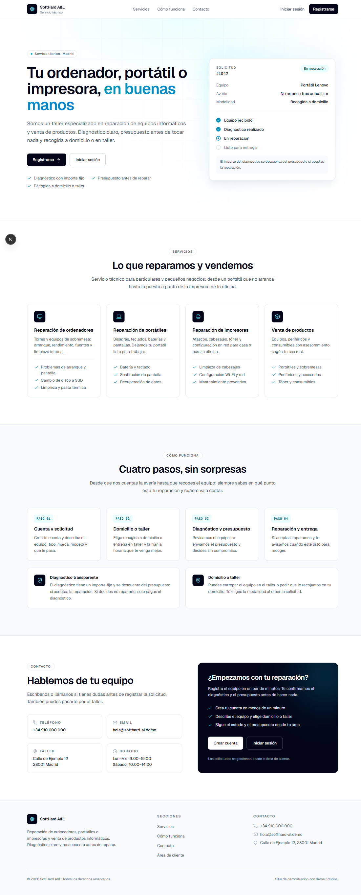
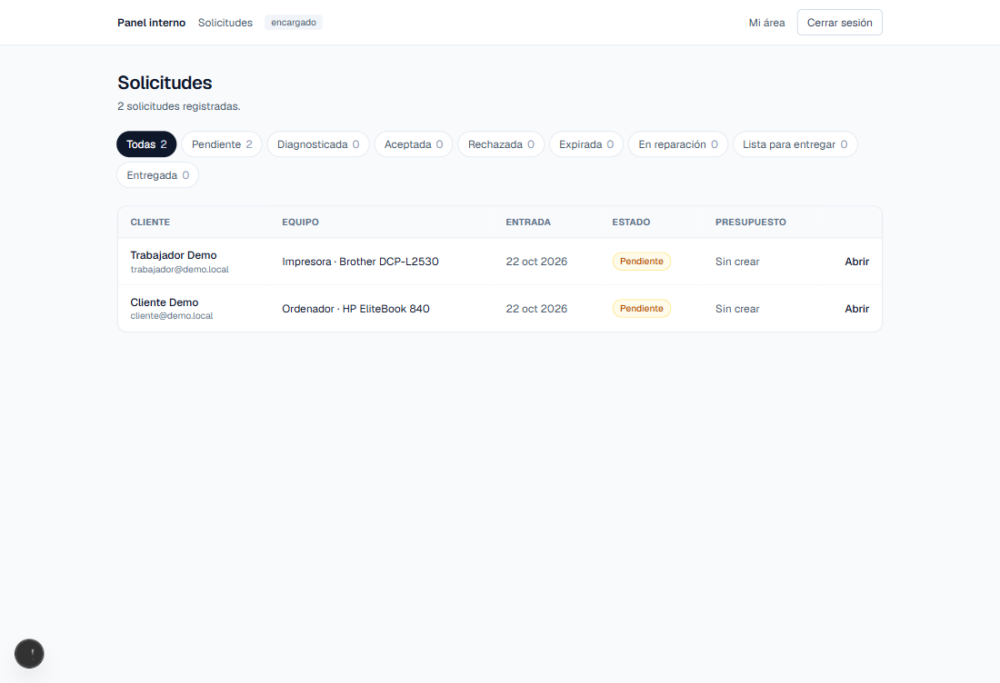
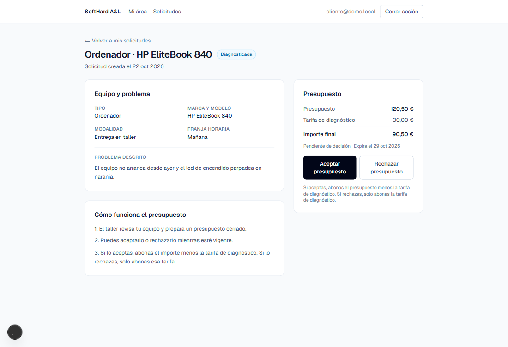

# SoftHard A&L

**Web de servicios técnicos y venta de productos de informática.** Reparación de ordenadores, portátiles e impresoras, con solicitud online, presupuesto y seguimiento desde el área de cliente.

Proyecto de portafolio de **Alexander Nevado**. Los usuarios, solicitudes, importes y marcas que aparecen en la aplicación son **datos ficticios**: no hay clientes ni pagos reales.

`Fase 1 completada` · `Fase 2 completada` · `Fase 3 completada` · `Next.js 15` · `TypeScript` · `PostgreSQL` · `492 tests + 13 de integración`

## Capturas

**Landing pública**



**Panel del encargado**



**Detalle de la solicitud**



## Índice

- [Capturas](#capturas)
- [Qué es](#qué-es)
- [Funcionalidad](#funcionalidad)
- [Stack tecnológico](#stack-tecnológico)
- [Puesta en marcha](#puesta-en-marcha)
- [Usuarios de prueba](#usuarios-de-prueba)
- [Scripts](#scripts)
- [Estructura del proyecto](#estructura-del-proyecto)
- [Decisiones de arquitectura](#decisiones-de-arquitectura)
- [Roadmap](#roadmap)
- [Fuera de alcance](#fuera-de-alcance)
- [Documentación](#documentación)

## Qué es

SoftHard A&L es una aplicación full stack que cubre el ciclo completo de una reparación:

1. El visitante conoce el taller y sus servicios.
2. El cliente se registra y crea una solicitud indicando equipo, avería, modalidad y franja horaria.
3. El encargado revisa la solicitud, emite un presupuesto y gestiona su estado.
4. El cliente acepta o rechaza el presupuesto dentro del plazo y ve el importe final que le corresponde.
5. El taller asigna la reparación a un trabajador, que la sigue desde `/trabajador`: cambia su estado, ficha su tiempo, deja notas o avisa de que falta una pieza hasta dejarla lista para entregar.
6. El encargado vigila el taller: reparaciones sin actividad, devueltas, faltas de repuesto, fichajes y horas por trabajador y por reparación.

La Fase 2 está completada: catálogo público, ficha de producto, panel interno de productos, carrito local, checkout con historial de pedidos, gestión administrativa de pedidos y libro de stock con ajustes e historial.

La Fase 3 (taller interno) está completada: asignación, panel del trabajador, fichaje, notas y faltas de repuesto, avisos de reparaciones sin actividad y reportes del encargado.

## Funcionalidad

### Fase 1: servicio técnico

#### Público

- Landing con hero, servicios, cómo funciona y contacto.
- Registro de nuevos clientes con email único y contraseña hasheada.

#### Cliente

- Inicio y cierre de sesión.
- Creación de solicitudes con validación en servidor: tipo de equipo, marca, modelo, problema, modalidad (domicilio o taller), dirección de recogida (obligatoria solo a domicilio) y franja horaria.
- Listado de sus propias solicitudes y página de detalle.
- Visualización del presupuesto: importe, tarifa de diagnóstico e importe final.
- Aceptación o rechazo del presupuesto, con expiración automática a los 7 días.

#### Encargado / administrador

- Panel con todas las solicitudes y filtro por estado con contadores.
- Detalle de cada solicitud con datos del cliente, equipo y problema.
- Creación del presupuesto con vista previa del importe final.
- Cambio de estado entre los 9 estados del flujo (`pendiente`, `diagnosticada`, `aceptada`, `rechazada`, `expirada`, `en_reparacion`, `esperando_repuesto`, `lista` y `entregada`). Desde la Fase 3 lo decide una máquina de transiciones: fuera del flujo normal, el staff corrige con motivo obligatorio.

### Fase 2 (completada)

- Catálogo público en `/productos`, accesible sin iniciar sesión.
- Filtros por categoría; cada tarjeta muestra precio, stock y aviso de producto agotado.
- Ficha pública en `/productos/[id]` con imagen, descripción, precio, disponibilidad y acceso al carrito.
- Carrito en `/carrito` con persistencia en LocalStorage, contador de unidades en la cabecera, control de cantidades, subtotales y total.
- El carrito revalida precios y stock en servidor, respeta la disponibilidad y retira productos agotados o inactivos con aviso.
- El navegador solo guarda `productId` y `quantity`; nunca precios ni copias del producto.
- Catálogo interno en `/admin/productos` con listado, precio, stock y categoría.
- Alta de productos con stock inicial y edición sin campo de stock: el stock solo cambia por movimientos.
- Borrado lógico: el producto se archiva y deja de mostrarse en el catálogo.
- Seis productos de demostración creados por el seed, uno de ellos agotado.
- Solo `encargado` y `admin` acceden al panel; `cliente` y `trabajador` son redirigidos.
- Checkout desde `/carrito`: los visitantes inician sesión y vuelven al carrito sin perder productos; los clientes crean un pedido con el total calculado en servidor.
- El stock se descuenta en una transacción atómica. Si una línea no tiene existencias, no se crea el pedido y el carrito se ajusta al stock real.
- Clave de idempotencia por usuario para evitar pedidos duplicados por doble clic o reintentos.
- Página de éxito/detalle en `/app/pedidos/[id]` e historial en `/app/pedidos`, filtrado por propietario.
- Libro de stock con `stock_inicial`, `venta`, `cancelacion_pedido`, `reposicion` y `ajuste`; la invariante `stock = suma de movimientos` se mantiene en la misma transacción.
- Ajuste manual de stock solo para `encargado` y `admin`, con motivo, variación, nota, vista previa y rechazo de stock negativo. Historial de los últimos 10 movimientos en la ficha del producto.
- Panel `/admin/pedidos` con filtro por estado, contadores, cliente, fecha, total y estado; detalle con líneas a precio congelado y total.
- Transiciones `pendiente → pagado | cancelado` y `pagado → entregado | cancelado`, aplicadas con actualización condicional sobre el estado esperado.
- Cancelación transaccional: repone todas las líneas (también archivadas), crea un movimiento positivo por línea y no repone dos veces. Cancelar un pedido pagado exige motivo y avisa de que no hay reembolso.
- Los pedidos nacen en estado `pendiente`; «pagado» se marca a mano porque no hay pasarela de pago.

### Fase 3: taller interno (completada)

Spec completa en [`docs/specs/fase-3.md`](docs/specs/fase-3.md). La unidad de trabajo es la propia solicitud de reparación; no hay tickets internos.

- **3.1 Datos y permisos:** estado `esperando_repuesto`; historiales de estados y de asignaciones; fichajes (`WorkLog`) y notas internas; fecha de última actividad; parámetros de aviso en `Config`. La base de datos impide dos fichajes abiertos del mismo trabajador y una salida anterior a la entrada. Ruta `/trabajador` para trabajador, encargado y admin, protegida en middleware, layout y acciones.
- **3.2a Transiciones:** una única función pura decide qué cambio de estado es válido para cada rol. El trabajador asignado avanza por `aceptada → en_reparacion ⇄ esperando_repuesto` y `en_reparacion → lista`; solo encargado y admin marcan `entregada`. Todo cambio deja historial, actualiza la última actividad y cierra el fichaje abierto cuando el estado deja de ser `en_reparacion`.
- **3.2b Asignación:** el encargado asigna y reasigna desde el detalle del panel; un trabajador toma una reparación aceptada sin responsable (si otro la tomó antes, falla con un mensaje claro) o la devuelve con motivo obligatorio. Cada cambio de responsable queda en su historial.
- **3.3 Panel del trabajador:** en `/trabajador`, mobile-first, sus reparaciones agrupadas por estado (primero las que exigen acción) y las aceptadas sin responsable para tomar. El detalle muestra equipo, avería, visita, botones de cambio de estado según la máquina de transiciones, devolución e historiales. Nunca muestra email ni teléfono del cliente; una reparación ajena devuelve 404.
- **3.4 Fichaje:** el trabajador ficha entrada y salida en una reparación suya en `en_reparacion` o en horas generales con nota obligatoria; tarjeta del fichaje actual en `/trabajador`, aviso si lleva abierto más de las horas configuradas e historial semanal en `/trabajador/fichajes`. El encargado ve los fichajes abiertos, los cierra y corrige entrada, salida y nota en `/admin/fichajes`, con constancia de quién y cuándo.
- **3.5 Notas y falta de repuesto:** notas internas ligadas a la reparación, normales o de falta de repuesto; el trabajador escribe en las suyas abiertas y el staff en cualquiera. Las faltas pendientes se destacan en el listado del panel hasta que el encargado las marca como atendidas. El cliente nunca las ve.
- **3.6 Avisos sin actividad:** cada página de `/trabajador` avisa de las reparaciones propias que superan las horas sin actividad configuradas, con enlace a cada una; el aviso desaparece con cualquier actividad. El panel muestra el bloque «Requieren atención» con las reparaciones sin actividad y las devueltas sin responsable. Una reparación devuelta ya no se puede tomar: solo la reasigna el encargado.
- **3.7 Vistas y reportes:** `/admin/reportes` con horas por trabajador y por reparación (semana y acumulado), reparaciones por estado y listas completas de avisos; lista de fichajes filtrable por trabajador y semana; historial de estados en el detalle de la solicitud y filtro de solicitudes con faltas de repuesto pendientes. Las semanas van de lunes a domingo en hora de Madrid.

## Stack tecnológico

| Capa | Tecnología |
|---|---|
| Framework | Next.js 15.5 (App Router, Server Components y Server Actions) |
| UI | React 19.1 + Tailwind CSS 4 |
| Lenguaje | TypeScript 5 en modo estricto |
| Base de datos | PostgreSQL 16 + Prisma 7 con driver adapter (`@prisma/adapter-pg`) |
| Autenticación | Auth.js v5 (JWT) + `bcrypt` |
| Validación | Zod 4 |
| Tests | Vitest 5 |
| Tooling | ESLint 9 · Turbopack en desarrollo |

## Puesta en marcha

### Requisitos

- **Node.js 24** (la versión exacta está en `.nvmrc`) y npm.
- **Docker** (recomendado) o un **PostgreSQL 16** local.
- Git.

### Paso a paso

```bash
# 1. Clona el repositorio (privado: solicita acceso)
git clone <url-del-repositorio>
cd softhard-al

# 2. Instala las dependencias
npm install

# 3. Crea el archivo de entorno a partir del ejemplo
cp .env.example .env
```

Edita `.env` y genera un secreto para `AUTH_SECRET`:

```bash
# Git Bash, WSL o macOS/Linux
openssl rand -base64 32
```

En Windows sin OpenSSL, usa Git Bash/WSL o cualquier generador de secretos de al menos 32 bytes.

| Variable | Descripción |
|---|---|
| `DATABASE_URL` | Cadena de conexión a PostgreSQL |
| `AUTH_SECRET` | Secreto con el que se firman los JWT |
| `AUTH_URL` | URL base de la aplicación (`http://localhost:3000`) |
| `NEXTAUTH_URL` | Compatibilidad con Auth.js v4; mismo valor que `AUTH_URL` |
| `EMAIL_PROVIDER` | Opcional. `console` (por defecto: no envía nada), `mailpit` en desarrollo; `resend`, preparado pero no activo |
| `MAILPIT_URL` | Opcional. API de Mailpit (`http://localhost:8025`) |
| `EMAIL_FROM` | Opcional. Remitente de los emails (`SoftHard A&L (demo) <no-reply@softhard-al.demo>`) |
| `APP_URL` | Opcional. URL base de los enlaces de los emails (`http://localhost:3000`) |
| `PAYMENT_PROVIDER` | Opcional. `mock` (por defecto): pasarela simulada en `/pago/mock/<sesión>`, sin cobros reales; `stripe`, reservado y no activo |

```bash
# 4. Levanta PostgreSQL con Docker
docker compose up -d
```

Si prefieres un PostgreSQL local, crea la base de datos y ajusta `DATABASE_URL`:

```bash
createdb softhard
```

```bash
# 5. Aplica migraciones y genera el cliente de Prisma
npx prisma migrate dev

# 6. Carga la configuración, los usuarios y los productos de demostración
npx prisma db seed

# 7. Arranca el servidor de desarrollo
npm run dev
```

Abre [http://localhost:3000](http://localhost:3000).

> `src/generated/` está excluido del repositorio. Si el cliente de Prisma no existe tras el clone, ejecuta `npx prisma generate`.

### Emails en desarrollo (Mailpit)

La app envía tres emails transaccionales: pedido confirmado (al crear el pedido), presupuesto listo y reparación lista. Se encolan en la tabla `pending_emails` en la misma transacción que el evento y los envía un worker. En desarrollo se capturan con [Mailpit](https://mailpit.axllent.org/): nada sale a Internet.

```bash
# 1. Levanta Mailpit (solo escucha en localhost: SMTP 1025, web 8025)
docker compose up -d mailpit
```

Sin Docker, descarga el binario de Mailpit para tu sistema desde sus *releases* en GitHub y ejecútalo; usa los mismos puertos por defecto.

Añade a tu `.env` `EMAIL_PROVIDER="mailpit"` y reinicia `npm run dev`. Sin esa variable se usa `console`, que no envía nada.

```bash
# 2. Arranca el worker de la cola (en otra terminal)
npm run worker:emails
```

Abre [http://localhost:8025](http://localhost:8025). Tras cada acción que encola, la app intenta además un envío inmediato (`after()` de Next), así que los emails suelen llegar aunque el worker no esté arrancado; si ese envío falla, lo recoge el worker. Los fallidos (5 intentos) se ven y se reintentan en `/admin/emails`. La entrega es **al menos una vez**: si el proceso cae justo entre el envío y la marca `enviado`, ese email puede llegar dos veces.

### Producción

```bash
npm run build
npm run start
```

### Problemas frecuentes

- **El puerto 5432 está ocupado:** cambia el mapeo en `docker-compose.yml` (por ejemplo `5433:5432`) y actualiza `DATABASE_URL`.
- **Error de cliente Prisma no inicializado:** ejecuta `npx prisma generate`.
- **Falta `AUTH_SECRET`:** genera uno nuevo y reinicia el servidor.

## Usuarios de prueba

El seed es idempotente y crea cuatro cuentas con la misma contraseña: **`Demo1234!`**

| Email | Rol | Acceso |
|---|---|---|
| `cliente@demo.local` | cliente | `/app` |
| `trabajador@demo.local` | trabajador | `/trabajador` (sus reparaciones, las de tomar, fichaje, notas y su historial de fichajes) y `/app`; sin acceso al panel |
| `encargado@demo.local` | encargado | `/admin` (solicitudes, asignaciones, notas, fichajes, reportes, pedidos, productos y stock) y `/trabajador` |
| `admin@demo.local` | admin | `/admin` (solicitudes, asignaciones, notas, fichajes, reportes, pedidos, productos y stock) y `/trabajador` |

En el panel, `admin` y `encargado` comparten permisos. Solo el rol `trabajador` ficha. El seed también crea la configuración de negocio (**30 €** de tarifa de diagnóstico, **7 días** de validez del presupuesto, aviso a las **48 h** sin actividad y fichaje abierto a las **8 h**) y seis productos de demostración para el catálogo. No crea solicitudes de reparación.

## Scripts

| Comando | Qué hace |
|---|---|
| `npm run dev` | Servidor de desarrollo con Turbopack |
| `npm run build` | Build de producción |
| `npm run start` | Sirve el build de producción |
| `npm run lint` | ESLint |
| `npm run typecheck` | Comprobación de tipos con TypeScript |
| `npm run test` | Ejecuta la suite de Vitest una vez |
| `npm run test:watch` | Vitest en modo vigilancia |
| `npm run test:integration` | Tests de integración contra PostgreSQL real (base `softhard_test`) |

Comandos de base de datos:

```bash
npx prisma migrate dev   # aplica migraciones en desarrollo
npx prisma db seed       # carga configuración, usuarios y productos demo
npx prisma studio        # explora la base de datos
```

## Estructura del proyecto

```text
src/
  app/
    (public)/              landing, catálogo y carrito
    (auth)/                login y registro
    app/                   área del cliente (solicitudes y pedidos)
    admin/                 panel interno (solicitudes, fichajes, reportes, pedidos y productos)
    trabajador/            área de taller (mis reparaciones, detalle y mis fichajes)
    api/auth/              handler de Auth.js
  components/
    site/                  landing, cabecera y catálogo público
    cart/                  provider, contador y vista del carrito
    orders/                badge de estado de pedido
    service-requests/      solicitudes, presupuestos y decisión
    admin/                 solicitudes, asignación, fichajes, notas, avisos, pedidos, productos y stock
    taller/                tarjetas, fichaje, notas, avisos e historiales del área de taller
  lib/
    auth.ts, authz.ts      autenticación y permisos
    navigation.ts          callback interno seguro tras login/registro
    service-status.ts      máquina de transiciones de estado de las reparaciones
    worker-requests.ts     agrupación y acciones del panel del trabajador
    work-logs.ts           duración de fichajes y semanas/horas en Europe/Madrid
    request-notes.ts       tipos y orden de las notas internas
    inactivity.ts          plazo y estados de los avisos sin actividad
    reports.ts             agregaciones de horas por trabajador y por reparación
    format.ts              importes y fechas (siempre en hora de Madrid)
    orders.ts              estados, transiciones, tipos y cálculo puro de pedidos
    stock.ts               motivos, límites y textos del libro de stock
    quotes.ts              reglas puras de importes y expiración
    products.ts            categorías y tipos del catálogo
    catalog.ts             filtros y textos de stock del catálogo público
    cart.ts                persistencia, stock e importes del carrito
    validations/           esquemas Zod
  server/
    authorization.ts       guards requerirStaff y requerirPersonalTaller (rol revalidado en BD)
    actions/               Server Actions (mutaciones, carrito, checkout, panel, stock y taller)
    data/                  acceso a datos con control de propiedad y de responsable
prisma/
  schema.prisma
  migrations/
  seed.ts
public/productos/          placeholder de producto
docs/specs/               especificaciones de las fases 1, 2 y 3
```

## Decisiones de arquitectura

### Regla del descuento

La tarifa de diagnóstico **X** y los días de validez **N** viven en la tabla `Config`. Al crear un presupuesto, **X se copia** en el propio presupuesto para que un cambio futuro de tarifa no altere documentos ya emitidos.

- **Aceptar:** el importe final es `presupuesto − X`.
- **Rechazar:** el importe final es `X` (solo se abona el diagnóstico).
- **Expirar:** si pasan **N** días sin respuesta, el presupuesto caduca y ya no admite decisión.

Los importes se calculan en **céntimos** con funciones puras y se persisten como `Decimal(10,2)`, evitando la deriva de la coma flotante. El servidor recalcula siempre el importe: nunca acepta cantidades del formulario.

La expiración es **perezosa**: no hay cron. Al leer una solicitud se comprueba `expiresAt` y, si corresponde, se actualizan el presupuesto a `expirado` y la solicitud a `expirada` de forma idempotente.

### Carrito local con precios de servidor

El carrito de la Fase 2 se guarda en **LocalStorage** bajo la clave versionada
`softhard-carrito-v1` para que el visitante pueda montar su compra sin cuenta. El
checkout exige iniciar sesión, pero guardar el carrito en base de datos obligaría a
crear un carrito anónimo, limpiar carritos huérfanos y sincronizarlo al iniciar
sesión: complejidad que no aporta valor en esta tarea.

La decisión clave es que el navegador **solo almacena `productId` y `quantity`**.
Nunca guarda precios, nombres ni stock: esos datos podrían quedar obsoletos o ser
manipulados. Al abrir `/carrito`, una **Server Action pública** recibe los IDs y
consulta Prisma para devolver el precio y el stock actuales. Los subtotales y el
total se calculan en **céntimos** con funciones puras.

El carrito se reconcilia con el servidor: los productos inexistentes, inactivos o
agotados se retiran con un aviso, y las cantidades superiores al stock se ajustan.
El contador de cabecera suma unidades, no líneas. El checkout exige cuenta, pero
el carrito sigue siendo local: iniciar sesión no lo sincroniza con la base de datos.

### Checkout atómico e idempotente

Crear un pedido implica tres escrituras que deben ocurrir juntas: descontar stock,
crear `Order` y crear `OrderItem`. La operación se ejecuta dentro de una única
transacción de Prisma. Cada stock se descuenta con un `updateMany` condicional
(`active = true` y `stock >= cantidad`), ordenado por id de producto para reducir
bloqueos cruzados. Si otra compra se lleva la última unidad, la condición falla,
la transacción se revierte y no queda un pedido a medias.

El cliente genera una clave UUID por intento de compra. La tabla `orders` tiene una
restricción única `(userId, idempotencyKey)`: un doble clic, un reintento de red o
una respuesta perdida devuelven el pedido ya creado en lugar de duplicarlo. Si dos
peticiones compiten, solo una inserta; la otra captura la violación de unicidad y
consulta el pedido ganador.

El total y los precios unitarios se calculan en servidor a partir de los productos
actuales. `OrderItem.price` congela el precio del momento de la compra para que un
cambio posterior del catálogo no altere el histórico.

### Libro de stock y ajustes manuales

`Product.stock` no se edita directamente: es la suma de `StockMovement.variation`.
Cada venta, cancelación, reposición, ajuste o alta con stock genera un movimiento en
la misma transacción que cambia el stock. La migración de 6A dejó un `stock_inicial`
para cada producto con stock mayor que cero, incluidos los archivados.

Los ajustes manuales están limitados a `encargado` y `admin`, revalidados en servidor.
La reposición es positiva; el ajuste admite signo y exige nota; ambos rechazan cero,
valores no enteros y más de **10.000 unidades** por movimiento. La actualización usa
una condición atómica para no dejar stock negativo y el movimiento se guarda en la
misma transacción. La ficha del panel muestra los últimos 10 movimientos y enlaza al
pedido cuando existe.

**Deuda conocida:** un pedido pendiente retiene el stock descontado hasta que se
cancela; no hay liberación automática ni reserva al añadir al carrito.

### Taller: concurrencia y reglas en servidor

La unidad de trabajo es la propia `ServiceRequest`; fichajes, notas e historiales
cuelgan de ella. Una única función pura (`lib/service-status.ts`) decide qué cambio
de estado es válido para cada rol, y las acciones del taller se aplican con un
`updateMany` condicional sobre la reparación (responsable, estado esperado) que,
además, actualiza `lastActivityAt` y bloquea la fila frente a cambios simultáneos.

- **Un solo fichaje abierto por trabajador:** lo garantiza un índice único parcial
  sobre `work_logs(userId) WHERE endedAt IS NULL`; un check impide una salida anterior
  a la entrada. Un doble clic o dos dispositivos reciben «ya tienes un fichaje abierto».
- **Cierre automático:** todo estado distinto de `en_reparacion`, una reasignación o
  una devolución cierran el fichaje abierto en la misma transacción.
- **Tomar una reparación** es condicional: si otro la tomó antes, falla con un mensaje
  claro. Las devueltas solo las reasigna el encargado.
- **Avisos perezosos:** no hay cron. Las reparaciones sin actividad se calculan al
  cargar la página comparando `lastActivityAt` con `Config.inactiveRequestHours`.
- **Zona horaria:** los instantes se guardan en UTC y se muestran en Europe/Madrid;
  las semanas van de lunes a domingo en Madrid y un fichaje cuenta entero en la semana
  en la que empieza. Sin dependencias de fechas: `Intl` y tests con los cambios de hora.

### Gestión administrativa de pedidos

Las transiciones viven en una única función pura: `pendiente → pagado | cancelado` y
`pagado → entregado | cancelado`; `entregado` y `cancelado` son finales. Cada cambio
se aplica con `updateMany` condicional sobre el estado esperado, de modo que dos
pestañas o un doble clic no se pisan: la perdedora recibe un mensaje para recargar.

La cancelación lee las líneas dentro de la transacción y solo después de que la
actualización condicional haya cambiado una fila. Repone todas las líneas, incluidas
las de productos archivados, y crea un movimiento positivo `cancelacion_pedido` por
línea, ligado al pedido y al usuario. Una segunda cancelación no repone stock. Si el
pedido estaba pagado, se exige motivo y se avisa de que no se gestiona reembolso.

### Seguridad y permisos

- **Contraseñas** con `bcrypt` (coste 12). El registro público siempre asigna el rol `cliente`; Zod descarta cualquier `role` inyectado.
- **Middleware** en el edge para separar `/app` (cualquier sesión), `/admin` (solo `encargado` y `admin`) y `/trabajador` (`trabajador`, `encargado` y `admin`).
- **Revalidación del rol en cada Server Action** (`requerirStaff`, `requerirPersonalTaller`): el JWT no se considera prueba suficiente.
- **Propiedad de los datos**: las consultas del cliente filtran por `{ id, clientId }`; los pedidos filtran por `{ id, userId }`; el trabajador solo ve sus reparaciones y las aceptadas sin responsable (nunca devueltas), y sus fichajes y notas, con el filtro en la propia consulta. Un identificador ajeno devuelve 404, sin revelar si existe.
- **Privacidad del cliente en el taller**: el trabajador nunca recibe email ni teléfono del cliente, y de una reparación libre no recibe ni el nombre ni los historiales. El área de cliente nunca selecciona notas, fichajes ni historiales internos (fijado con tests).
- **Importes y estados** se validan en servidor; los formularios solo envían la intención (`aceptar`, `rechazar`) y el checkout nunca envía precios ni totales.
- **Callback seguro**: tras login o registro solo se acepta una ruta interna; se rechazan URLs externas, protocolos peligrosos y el acceso de un cliente al panel.

### Tests

La lógica sensible está aislada en funciones puras y cubierta con **Vitest**: reglas de importes, transiciones de estado, expiración, validaciones Zod y permisos básicos.

- **492 tests unitarios** en 56 archivos (`npm run test`, sin base de datos), incluidos validación, acciones, filtros del catálogo, carrito, cálculo de pedidos, conflictos de stock, idempotencia, edición sin stock, ajustes manuales, historial, transiciones de pedidos y de reparaciones, asignación, toma y devolución, visibilidad del panel del trabajador, fichaje, notas, avisos de inactividad, semanas y cambios de hora, reportes, límite de intentos de login y dirección de recogida. La capa de datos se prueba con Prisma mockeado.
- **13 tests de integración** (`npm run test:integration`) contra PostgreSQL real: índice único parcial de fichajes (`P2002`), check de salida, filtros por relación en `updateMany`, recuentos filtrados, cambio de hora en los reportes, límite de login y privacidad del cliente. Usan una base aparte, `<base>_test`, derivada de `DATABASE_URL` (solo hosts locales); cada test va en una transacción que se revierte, y antes se aplican las migraciones con `prisma migrate deploy`. La base se crea una vez:

  ```bash
  docker compose exec db createdb -U postgres softhard_test
  ```
- TypeScript estricto y ESLint en cada cambio.
- **Integración continua** (`.github/workflows/ci.yml`, GitHub Actions): en cada push a `main` y en cada pull request ejecuta lint → tipos → tests unitarios → tests de integración → `prisma migrate deploy` → `npm run build`, contra un PostgreSQL 16 de usar y tirar en el propio runner (credenciales ficticias en el workflow, sin secretos ni despliegue). Una ejecución nueva cancela la anterior de la misma rama. Para que una PR no se pueda fusionar en rojo, protege `main` en GitHub (*Settings → Branches → Add rule*: *Require status checks to pass* con el check **Lint, tests y build**); es un ajuste del repositorio, no del código.
- **Deuda conocida:** los pedidos pendientes retienen stock hasta que se cancelan y no se libera automáticamente; checkout y pedidos aún no tienen tests de integración.

### Server Components y Server Actions

- **Server Components por defecto**; los componentes cliente se limitan a formularios e interacción.
- Las páginas no tocan Prisma: la capa `src/server/data` concentra consultas y control de propiedad.
- Las mutaciones son **Server Actions** con validación Zod y revalidación de rutas.
- Los formularios controlados usan `onSubmit` + `useTransition` para evitar el reset de formularios de React 19 y conservar lo escrito ante errores.

## Roadmap

### Fase 1 — completada

- [x] Landing pública con servicios y contacto.
- [x] Registro, login y logout con Auth.js.
- [x] Rutas `/app` y `/admin` protegidas por rol en servidor.
- [x] Solicitudes de servicio con validación Zod.
- [x] Listado y detalle de solicitudes del cliente.
- [x] Panel del encargado con filtros por estado.
- [x] Presupuestos con la regla del descuento.
- [x] Aceptación, rechazo y expiración del presupuesto.
- [x] Tests de la lógica de negocio.
- [x] README con instrucciones.

### Fase 2 — completada

- [x] Modelo `Product` y migración.
- [x] CRUD interno de productos en `/admin/productos`.
- [x] Productos demo en el seed y tests de validación/acciones.
- [x] Catálogo público con filtros por categoría y estados de stock.
- [x] Fichas públicas de producto.
- [x] Carrito local con contador, cantidades, total y revalidación de precios/stock.
- [x] Checkout autenticado, pedidos, descuento atómico de stock e idempotencia.
- [x] Historial y detalle de pedidos del cliente.
- [x] Libro de stock, ajustes manuales e historial por producto.
- [x] Gestión administrativa de pedidos, transiciones y cancelación con reposición.

### Fase 3 — completada

- [x] 3.1 Datos y permisos del taller.
- [x] 3.2a Máquina de transiciones de estado con historial.
- [x] 3.2b Asignación, toma y devolución con historial.
- [x] 3.3 Panel del trabajador: mis reparaciones, detalle y reparaciones por tomar.
- [x] 3.4 Fichaje con historial semanal, cierre y corrección del encargado.
- [x] 3.5 Notas y falta de repuesto con atención del encargado.
- [x] 3.6 Avisos de reparaciones sin actividad y devueltas sin responsable.
- [x] 3.7 Vistas y reportes del encargado.

### Deuda técnica — completada

- [x] D1 Límite de intentos fallidos de inicio de sesión (5 por email y 20 por IP en 15 minutos).
- [x] D2 Todos los formularios con `onSubmit` + `useTransition`: no se pierde lo escrito ante un error.
- [x] D3 Dirección de recogida en las visitas a domicilio.
- [x] D4 Tests de integración contra PostgreSQL real.
- [x] D5 El panel de fichajes conserva semana y trabajador tras cerrar o corregir.
- [ ] Capturas del README con el taller (manual).

## Fuera de alcance

Estas funciones quedan fuera del alcance actual (ver también la spec de la Fase 3):

- Pagos reales, pasarela de pago, reembolsos y facturación.
- Historial de estados de pedido.
- Integración del catálogo con el área de cliente (recomendaciones o personalización).
- Reserva de stock al añadir al carrito o liberación automática de pedidos pendientes.
- Sincronización del carrito con la cuenta al iniciar sesión.
- Cupones, envíos e impuestos.
- Tickets internos e inventario de repuestos.
- Pausas, aprobación de horas y nóminas.
- Contabilidad.
- Emails automáticos y notificaciones push.
- Historial completo de correcciones de fichajes y control de solapes tras una corrección: solo se guarda el último editor (deuda anotada).
- Rate limiting en el login (deuda técnica anotada).

## Documentación

- [`docs/specs/fase-1.md`](docs/specs/fase-1.md) — objetivos, historias de usuario y criterios de aceptación de la Fase 1.
- [`docs/specs/fase-2.md`](docs/specs/fase-2.md) — alcance del catálogo, el carrito, el checkout y criterios de la Fase 2.
- [`docs/specs/fase-3.md`](docs/specs/fase-3.md) — taller interno: estados, asignación, fichaje, notas, avisos, vistas, sub-fases y criterios de la Fase 3.
- [`AGENTS.md`](AGENTS.md) — convenciones y reglas de trabajo del repositorio.
- [`memory.md`](memory.md) — estado y notas de continuidad del proyecto.

---

Proyecto de portafolio de **Alexander Nevado**. Todos los datos son ficticios y no se realiza ningún cobro real.
